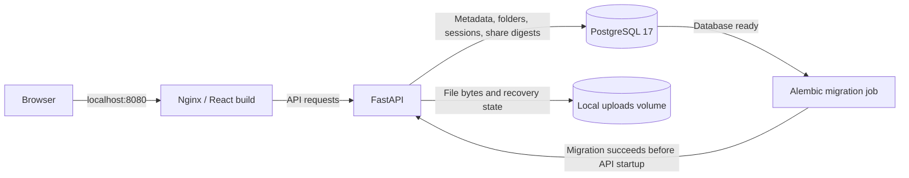

# ☁️ HomeSphere

**Your files. Your server. Your space.**

A self-hosted personal cloud portfolio demo with a graphite dashboard, an interactive 3D sphere, and a working file-management API. Upload files, organize them into folders, preview supported formats, recover deleted files, and create expiring download links—all backed by PostgreSQL and local file storage.

[Features](#key-features) · [Architecture](#architecture) · [Local setup](#local-setup) · [API documentation](#api-documentation) · [Demo limitations](#demo-limitations)

> **Project scope:** HomeSphere is a single-owner, local demonstration of a full-stack storage application. The default deployment is accessible only from the host machine.

## Overview

HomeSphere brings the familiar personal-cloud workflow to a small, inspectable application. React handles the dashboard and file interactions; FastAPI manages authentication, metadata, and downloads; PostgreSQL stores application records; and a Docker volume stores the actual file bytes.

The interface includes file-type filters, search, grid and list layouts, storage summaries based on real file metadata, and a responsive layout. Docker Compose connects the services and runs database migrations before starting the API.

## Key features

| Feature | Implemented behavior |
| --- | --- |
| **Owner authentication** | Interactive account creation, password hashing, sign-in/sign-out, and database-backed cookie sessions. |
| **File uploads** | File picker or drag and drop, multiple files uploaded sequentially, upload progress, and a default **25 MiB per-file limit**. |
| **File management** | Attachment downloads, file renaming, file-type filters, sorting, and grid/list views. |
| **Nested folders** | Create virtual folders, navigate with breadcrumbs, and upload into the selected folder. |
| **Search and recent files** | Case-insensitive filename search across active folders; Recent uploads shows the ten newest active uploads. |
| **File previews** | Raster images, PDFs, UTF-8 text, and browser-supported audio/video. Unsupported formats remain downloadable. |
| **Recycle bin** | Restore files to their original folder or confirm permanent deletion. Trashed payloads remain on disk until permanently deleted. |
| **Expiring share links** | Anonymous attachment downloads with 1-hour, 24-hour, or 7-day expiry options in the UI, plus owner-controlled revocation. |
| **Storage overview** | Active-file byte totals, a breakdown by file type, and the latest upload. |
| **Interactive presentation** | A Three.js sphere with pause/rotate controls, reduced-motion handling, and responsive dashboard styling. |

New share links are shown once: copy the URL before closing the dialog. Moving a file to the recycle bin revokes its existing links; restoring the file does not reactivate them.

## Tech stack

| Layer | Technologies |
| --- | --- |
| Frontend | React 19, **JavaScript/JSX**, Vite 8, custom CSS |
| Interface and graphics | Three.js, React Three Fiber, Motion, Lucide React |
| Backend | Python 3.12, FastAPI, Uvicorn, Pydantic |
| Database | PostgreSQL 17, SQLAlchemy 2, Psycopg 3 |
| Schema migrations | Alembic |
| Authentication | pwdlib with Argon2 support, database-backed sessions |
| Deployment | Docker Compose, multi-stage frontend build, Nginx |
| Verification tools | pytest, Python smoke/restore scripts, optional Playwright browser checks |

The checked-in frontend uses JavaScript and custom CSS. TypeScript and Tailwind CSS are not configured in this repository.

## Architecture



- **web** serves the compiled frontend and forwards API and documentation requests to FastAPI.
- **api** handles private file operations, owner sessions, and anonymous share downloads.
- **db** stores file metadata, folders, owner credentials, sessions, and hashed share tokens.
- **migrate** runs `alembic upgrade head` after PostgreSQL is healthy; the API waits for successful completion.
- **postgres_data** and **uploads_data** are named Docker volumes that persist independently of container rebuilds.

Folders are database records rather than filesystem paths. Uploaded payloads use random internal storage keys; changing a display name does not rename a user-controlled path on disk. Upload and permanent-delete operations record durable intent, with a Linux file lock and recovery on startup or subsequent file operations.

## Screenshots

Screenshots are not included in the current source tree. Suggested captures for a portfolio walkthrough:

| View | What to show |
| --- | --- |
| Desktop dashboard | Graphite interface, 3D sphere, uploaded files, and storage breakdown |
| Folder workflow | Nested folders, breadcrumbs, and files inside a selected folder |
| Sharing and recovery | Expiring-link dialog and recycle-bin restore controls |
| Mobile layout | File actions and stacked dashboard on a narrow screen |

<!--
Optional: add real captures at the paths below, then move the image lines outside
this comment. These paths are placeholders; no screenshot files are bundled.


-->

## Local setup

### Prerequisites

- Git.
- Docker with **Docker Compose v2** and support for Linux containers.
- Ports **8080** and **8001** available on the host.
- Internet access for the initial image and dependency downloads.

On Windows, use Docker Desktop in Linux-container mode, typically with its WSL 2 backend. The backend uses Linux filesystem APIs; the Compose setup supplies that environment. Host installations of Node.js, Python, and PostgreSQL are unnecessary for the standard Docker setup.

### 1. Clone the repository

```sh
git clone https://github.com/Devcodehub2004/HomeSphere.git
cd HomeSphere
```

### 2. Configure the database

For a **fresh checkout**, copy the example configuration.

**Linux / macOS / WSL:**

```sh
cp .env.example .env
```

**Windows PowerShell:**

```powershell
Copy-Item .env.example .env
```

Open `.env` and replace the example database password in both settings:

```dotenv
POSTGRES_PASSWORD=replace-with-your-own-long-local-password
DATABASE_URL=postgresql+psycopg://homesphere:replace-with-your-own-long-local-password@db:5432/homesphere
MAX_FILE_SIZE_BYTES=26214400
```

Use the same password in both places. If the password contains URL-reserved characters, URL-encode its password component in `DATABASE_URL`; keep the actual password in `POSTGRES_PASSWORD`. The database hostname is `db` inside Compose.

These are database credentials, not dashboard login credentials. The owner account is created separately in step 4. Keep `.env` private.

For an existing installation, retain its existing `.env` and volumes. Changing `POSTGRES_PASSWORD` in this file does not reset a password in an already-initialized PostgreSQL volume.

### 3. Build and start the services

Run from the repository root:

```sh
docker compose config --quiet
docker compose up -d --build
docker compose ps -a
```

The expected startup sequence is **database healthy → migrations complete → API healthy → web**. The `migrate` container exiting with code `0` is normal.

To inspect startup problems:

```sh
docker compose logs --tail=100 db migrate api web
```

### 4. Create the owner account

```sh
docker compose exec api python -m app.create_owner
```

Follow the interactive prompts:

- **Username:** 3–64 characters, starting with a letter or number; letters, numbers, dots, underscores, and hyphens are accepted. Usernames are stored lowercase.
- **Password:** 12–128 characters, entered twice without echoing it to the terminal.

There is no default dashboard account or public registration. If an owner already exists, the command reports that and exits.

### 5. Open HomeSphere

| Service | Local address |
| --- | --- |
| Dashboard | [http://localhost:8080](http://localhost:8080) |
| Swagger UI | [http://localhost:8080/docs](http://localhost:8080/docs) |
| ReDoc | [http://localhost:8080/redoc](http://localhost:8080/redoc) |
| OpenAPI schema | [http://localhost:8080/openapi.json](http://localhost:8080/openapi.json) |
| API health | [http://localhost:8080/health](http://localhost:8080/health) |
| Database connectivity | [http://localhost:8080/db-health](http://localhost:8080/db-health) |
| Direct API/debug access | [http://localhost:8001/docs](http://localhost:8001/docs) |

Sign in with the owner account created above. Use one consistent hostname and port when signing in and making private API requests.

Both published ports bind to `127.0.0.1`. PostgreSQL has no published host port.

### Stop and restart

```sh
docker compose stop
docker compose start
```

To rebuild after source changes, run `docker compose up -d --build` again. Containers can be recreated while the named volumes retain their data.

**Do not use `docker compose down -v` to stop a deployment you want to keep:** it removes the named database and upload volumes. A useful backup must preserve both PostgreSQL data and uploaded file bytes.

### Optional: frontend development

With the Compose services running, use **Node.js 24** to match the frontend build image:

```sh
cd frontend
npm ci
npm run dev
```

Open [http://localhost:5173](http://localhost:5173). Vite proxies `/auth`, `/files`, `/folders`, `/public`, and `/health` to the API on port 8001. Use the documentation URLs on port 8080; the Vite proxy does not forward the documentation routes.

To check the frontend:

```sh
npm run lint
npm run build
```

## API documentation

The running application's Swagger UI and OpenAPI schema provide the complete request and response definitions.

Private file and folder routes require the `homesphere_session` cookie. Login, logout, and private writes require an `Origin` header matching the request's scheme, hostname, and port. For browser-based API exploration, sign in through the dashboard and open `/docs` at the same origin. This API uses cookie sessions rather than bearer-token authentication.

| Method | Route | Purpose |
| --- | --- | --- |
| POST | `/auth/login` | Sign in with `username` and `password` |
| GET | `/auth/me` | Read the current owner session |
| POST | `/auth/logout` | End the current session |
| GET / POST | `/folders` | List child folders or create a folder |
| GET / POST | `/files` | List file metadata or upload multipart field `file` |
| GET | `/files/recent` | List recent active uploads |
| GET | `/files/{file_id}/download` | Download an active file as an attachment |
| PATCH | `/files/{file_id}` | Rename a file with `{"name": "..."}` |
| DELETE | `/files/{file_id}` | Move a file to the recycle bin |
| POST | `/files/{file_id}/restore` | Restore a trashed file |
| DELETE | `/files/{file_id}/permanent` | Permanently delete a file already in the bin |
| GET / POST | `/files/{file_id}/shares` | List share metadata or create an expiring link |
| DELETE | `/files/{file_id}/shares/{share_id}` | Revoke a share |
| GET | `/public/{token}` | Download through a valid anonymous share link |

Useful parameters and payloads:

- `GET /files?folder_id=root` lists root-level active files; omitting `folder_id` includes all folders.
- `GET /files?trashed=true` lists recycled files; `q` filters names.
- File and folder list routes support `skip >= 0` and `limit` from 1 to 100.
- `POST /files?folder_id=<folder-uuid>` uploads into that folder; omit the parameter for root.
- `POST /folders` accepts `{"name": "Projects", "parent_id": null}`; use a folder UUID for a nested folder.
- `POST /files/{file_id}/shares` accepts `{"expires_in_hours": 24}`. The API permits 1–168 hours and returns a `path` containing the new secret token once.

The legacy `homes` model and migrations remain in the source history; the current app does not register a `/homes` route.

## Project structure

```text
HomeSphere/
├── .env.example                 # Local database and upload-size settings
├── compose.yaml                 # web, api, migrate, db, and persistent volumes
├── backend/
│   ├── Dockerfile
│   ├── requirements.txt
│   ├── alembic.ini
│   ├── app/
│   │   ├── main.py              # FastAPI app, middleware, and health routes
│   │   ├── auth.py              # Owner login and cookie sessions
│   │   ├── create_owner.py      # Interactive account provisioning
│   │   ├── database.py          # SQLAlchemy connection and sessions
│   │   ├── files.py             # Upload, list, download, rename, and trash
│   │   ├── cloud_features.py    # Folders, recent files, restore, and sharing
│   │   ├── cloud_access.py      # Folder checks and attachment streaming
│   │   ├── storage.py           # Local bytes, locking, and recovery
│   │   └── ...                 # Models and validation schemas
│   ├── migrations/             # Alembic environment and revision history
│   └── tests/                  # Authentication, files, cloud, migration tests
├── frontend/
│   ├── Dockerfile              # Node build → Nginx runtime
│   ├── nginx.conf              # Static serving and API proxy
│   ├── docker-entrypoint.sh    # Upload request-size configuration
│   ├── package.json
│   ├── vite.config.js
│   ├── public/login-ribbon.webp
│   ├── src/
│   │   ├── App.jsx             # Dashboard and file manager
│   │   ├── App.css
│   │   ├── AuthGate.jsx        # Sign-in flow
│   │   ├── authClient.js
│   │   ├── components/         # Sphere, file preview, and cloud dialogs
│   │   └── hooks/
│   └── tests/cloud.e2e.cjs     # Optional Playwright browser workflow
├── scripts/
│   ├── smoke_test.py           # Built-app authentication and file lifecycle
│   └── restore_test.py         # Restore-verification utility
├── VERIFICATION.md             # Previously recorded verification evidence
└── design-qa.md                # Design decisions and previous visual QA
```

## Verification

With Compose running, execute these from the repository root:

```sh
docker compose exec -T api python -m pytest -q -p no:cacheprovider
docker compose exec -T api alembic check
```

The normal backend suite uses temporary SQLite and storage fixtures. PostgreSQL-specific migration checks are skipped unless explicitly configured.

For an end-to-end HTTP smoke check, use a local Python 3 interpreter:

```sh
python3 scripts/smoke_test.py
```

On Windows, the equivalent is `py -3 scripts/smoke_test.py`. The script prompts for owner credentials, checks the built frontend and API, and exercises upload, byte-exact download, rename, recycle, restore, permanent deletion, and logout using its own temporary file.

The repository also includes an optional Playwright flow at [frontend/tests/cloud.e2e.cjs](frontend/tests/cloud.e2e.cjs). It requires a separate Playwright installation and an isolated demo instance/account; its empty test folders remain afterward.

**Database test isolation:** `HOMESPHERE_TEST_DATABASE_URL` and `HOMESPHERE_MIGRATION_TEST_URL` enable PostgreSQL tests that recreate tables or the public schema. Use only disposable databases named `homesphere_test_*`, never your personal cloud database.

[VERIFICATION.md](VERIFICATION.md) records earlier test and browser results. Those historical results are separate from verification performed on a new checkout.

## Demo limitations

- **Single owner:** no public signup, teams, roles, or multi-user dashboard.
- **Local access:** generated links use the current server address. A localhost link works on the host machine; access from another device requires deliberate network, HTTPS, trusted-host, and cookie configuration.
- **Storage scope:** payloads live in a local Docker volume. There is no object-storage integration, distributed locking, or built-in file encryption.
- **Upload configuration:** the API and Nginx read `MAX_FILE_SIZE_BYTES`; the current frontend upload check and preview cap remain fixed at **25 MiB**. Changing the environment value alone does not update the browser limit.
- **Preview support:** text previews show at most the first **1 MiB**. Audio/video depend on browser codec support; Office files and archives are download-only.
- **Folder operations:** folder rename/move/delete, moving existing files between folders, and folder sharing are not implemented.
- **Recycle-bin retention:** there is no automatic cleanup period. Recycled files still occupy disk space, while the dashboard's totals summarize active files and do not report physical disk capacity or free space.
- **Library size:** the API paginates metadata, but the UI collects the metadata pages for a compact personal library rather than presenting large-library pagination.
- **Sharing:** revocation blocks new download requests; an already-open download can finish. Public-link abuse throttling is not implemented.
- **Transfer features:** resumable uploads, background synchronization, and file version history are not implemented.

The implementation includes hashed passwords and share tokens, HttpOnly/SameSite session cookies, same-origin write checks, and private resource ownership checks. These are specific safeguards in a local portfolio demo, not a claim of production readiness.

## Attribution and license

HomeSphere is maintained in [Devcodehub2004/HomeSphere](https://github.com/Devcodehub2004/HomeSphere) by [Devcodehub2004](https://github.com/Devcodehub2004).

The application uses React, Vite, Three.js, React Three Fiber, Motion, Lucide React, FastAPI, SQLAlchemy, Psycopg, Alembic, pwdlib, PostgreSQL, and Nginx. The interface imports **Space Grotesk** through Google Fonts, with system-font fallbacks. Third-party projects retain their respective licenses.

[design-qa.md](design-qa.md) describes the dashboard as an adaptation of a user-supplied visual reference. The checked-in materials do not identify that reference's original creator; no separate authorship claim is made here.

**License:** No repository-level `LICENSE` file is present in the reviewed source tree. No project license is asserted by this README.

---

<sub>Documentation reviewed against the default branch at commit <a href="https://github.com/Devcodehub2004/HomeSphere/tree/f270e0f7ea21b391f62c1b1d8c2d8c35266d4a6a">f270e0f</a> on 29 October 2026. Feature and setup descriptions were checked against source files, dependency manifests, Dockerfiles, migrations, and Compose configuration; this documentation review does not claim a fresh runtime test pass.</sub>

