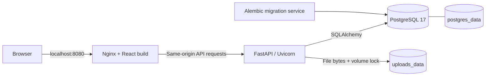

# HomeSphere

**A self-hosted personal cloud for organizing, previewing, and sharing files on your own server.**

HomeSphere pairs a React file manager with a FastAPI API, PostgreSQL metadata, and persistent local file storage. Its dark interface includes an interactive 3D storage sphere, nested folder browsing, expiring download links, and a recoverable recycle bin.

> **Project scope:** a single-owner portfolio demo configured for local access. The included deployment binds to loopback and is not ready for public internet exposure without further hardening.

[Features](#features) · [Screenshots](#screenshots) · [Quick start](#quick-start) · [Architecture](#architecture) · [Development and verification](#development-and-verification) · [Security and limitations](#security-and-limitations)

## Features

| Area | Implemented behavior |
| --- | --- |
| File management | File picker and drag-and-drop uploads with progress, attachment downloads, rename, grid/list layouts, category filters, and sorting by newest, name, or size. |
| Folders and search | Create nested virtual folders, navigate with breadcrumbs, and upload into the selected folder. Filename search in the Folders view spans active files across folders; Recent and Recycle bin searches stay within their views. |
| Recent uploads | View the latest ten active uploads across folders. Rename and restore preserve the original upload timestamp. |
| Previews | Raster images, PDFs, UTF-8 text, and browser-supported audio/video. Previews are limited to 25 MiB; text displays the first 1 MiB. Unsupported formats remain downloadable. |
| Recycle bin | Move files to the bin, restore them to their original folder, or confirm permanent deletion. Trashed files retain their bytes and continue to occupy disk space. |
| Sharing | Create anonymous attachment-download links with a 1-hour, 24-hour, or 7-day expiry in the UI. Copy a new link before closing the dialog; existing links can be revoked. Trashing a file revokes its links, and restore does not reactivate them. |
| Owner access | One locally provisioned account, password hashing, database-backed cookie sessions, logout, and checks on private resource ownership. |
| Interface | Responsive layouts, keyboard dialogs, reduced-motion handling, and a lazily loaded Three.js scene with a fallback. |

## Screenshots

No application screenshots are committed. The existing [login artwork](frontend/public/login-ribbon.webp) is a decorative background, not a screenshot.

| View | Screenshot placeholder |
| --- | --- |
| Desktop dashboard and folders | Add a capture of the running dashboard showing nested folders and the file manager. |
| File sharing | Add a capture of the sharing dialog with the bearer link concealed. |
| Mobile file manager | Add a capture of the grid or list layout on a narrow viewport. |

These are text placeholders rather than broken image links. The optional browser check below can save desktop, sharing, and mobile captures; review them for private filenames and share tokens before publishing.

## Quick start

### Prerequisites

- Git and Docker with the Compose v2 plugin, using Linux containers.
- A browser and available local ports **8080** (web) and **8001** (API diagnostics).
- Network access for the initial image and dependency downloads.

The containers provide Python 3.12, Node.js 24 for the frontend build, Nginx, and PostgreSQL 17. You do not need to install Python or Node.js on the host for the Compose deployment. On Windows, use Docker Desktop with Linux containers; WSL is suitable for the shell commands below. The backend uses Linux filesystem APIs and does not run natively on Windows.

### 1. Clone and configure

```sh
git clone https://github.com/Devcodehub2004/HomeSphere.git
cd HomeSphere
cp .env.example .env
```

In PowerShell, use `Copy-Item .env.example .env` for the final command.

Edit the new `.env` locally:

| Variable | Configuration |
| --- | --- |
| `POSTGRES_PASSWORD` | Set a strong password of your own; replace the example value. |
| `DATABASE_URL` | Use `postgresql+psycopg://homesphere:<URL_ENCODED_PASSWORD>@db:5432/homesphere`, replacing the placeholder with the same password, URL-encoded for the connection string. `db` is the Compose service hostname. |
| `MAX_FILE_SIZE_BYTES` | Defaults to `26214400` (25 MiB) for the API and Nginx. The current UI upload and preview limits are fixed at 25 MiB, so changing this variable alone does not update them. |
| `AUTH_COOKIE_SECURE` | Optional; defaults to `false` for local HTTP. Set to `true` only with an intentionally configured HTTPS deployment. |

Keep `.env` private; it is ignored by Git. The database password is separate from the owner account password created below. If you already have a deployment, retain its `.env` and volumes rather than copying over its settings. Changing `POSTGRES_PASSWORD` does not reset the password in an already initialized PostgreSQL volume.

### 2. Build and start

```sh
docker compose up -d --build
docker compose ps -a
```

Compose waits for PostgreSQL readiness, runs Alembic migrations, and then starts the API and web service. The `migrate` service should finish with exit code **0**; it does not stay running.

### 3. Create the owner account

After the API is ready, run:

```sh
docker compose exec api python -m app.create_owner
```

The command prompts for a username and a hidden password. Usernames use 3–64 letters, numbers, dots, underscores, or hyphens and must start with a letter or number; they are stored in lowercase. Passwords must be 12–128 characters. If an owner already exists, the command leaves it in place. There is no registration screen.

### 4. Open HomeSphere

- **Application:** [http://localhost:8080](http://localhost:8080)
- **Interactive API documentation:** [http://localhost:8080/docs](http://localhost:8080/docs)
- **API health:** [http://localhost:8080/health](http://localhost:8080/health)
- **Database health:** [http://localhost:8080/db-health](http://localhost:8080/db-health)

Sign in, create a folder, and upload a disposable file to try the full flow. Public links use the browser's current server address. A `localhost` link is usable on this machine; it does not make the file reachable from another device.

### Stop, restart, and troubleshoot

```sh
docker compose stop
docker compose start
```

To inspect startup failures, use:

```sh
docker compose logs --tail=100 db migrate api web
```

If startup fails, first check that Docker is running, both password settings match, and the local ports are free. After correcting settings, rerun `docker compose up -d --build`. A migration failure must be resolved before the API can start.

**Preserve your data:** do not run `docker compose down -v` on a deployment you want to keep. It removes the database and upload volumes. Review logs before sharing them and redact any private configuration.

## Architecture



- **Frontend:** [React 19 and Vite](frontend/package.json), with Motion, Lucide icons, Three.js, and React Three Fiber. Nginx serves the production build and forwards API requests on the same origin.
- **API:** [FastAPI](backend/app/main.py) handles [authentication](backend/app/auth.py), [file operations](backend/app/files.py), [folders, recycling, and public downloads](backend/app/cloud_features.py). SQLAlchemy manages database access; Alembic owns schema migrations.
- **Metadata:** PostgreSQL stores the owner, hashed sessions, file records, folder relationships, and hashed share tokens. Folders are virtual records, never filesystem paths.
- **Payloads:** [file bytes](backend/app/storage.py) live under random storage keys in `/data/uploads`. Uploads compute SHA-256 metadata. Durable operation states, filesystem synchronization, and a volume lock support cleanup of interrupted uploads and completion of pending permanent deletions.
- **Startup:** `db` healthy → `migrate` completes → `api` healthy → `web` starts. Both application images run as non-root users.

| Service | Host access | Persistence |
| --- | --- | --- |
| `web` | `127.0.0.1:8080` | Built frontend assets in the image |
| `api` | `127.0.0.1:8001` → container port 8000; normally accessed through Nginx | `uploads_data` mounted at `/data/uploads` |
| `db` | Internal Compose network only; no published database port | `postgres_data` mounted at `/var/lib/postgresql/data` |
| `migrate` | One-shot service with no published port | Updates the database schema |

### Repository layout

```text
HomeSphere/
├── backend/
│   ├── app/
│   │   ├── auth.py              # Owner sessions and Origin checks
│   │   ├── create_owner.py      # Interactive account provisioning
│   │   ├── files.py             # Upload, list, download, rename, recycle
│   │   ├── cloud_features.py    # Folders, restore, purge, share links
│   │   ├── cloud_access.py      # Ownership helpers and attachment responses
│   │   ├── storage.py           # Payload storage, locking, recovery
│   │   └── main.py              # API assembly, health routes, middleware
│   ├── migrations/             # Alembic schema history
│   └── tests/                  # Authentication, files, cloud, migration tests
├── frontend/
│   ├── src/                    # Auth gate, dashboard, dialogs, previews, 3D scene
│   ├── public/                 # Login artwork
│   ├── tests/cloud.e2e.cjs      # Optional Playwright browser check
│   └── nginx.conf              # Static serving and same-origin proxy
├── scripts/
│   ├── smoke_test.py           # Live API and frontend smoke check
│   └── restore_test.py         # Isolated restore verification for an existing backup
├── compose.yaml
└── .env.example
```

Legacy `homes` database rows and migration history remain for preservation; the old `/homes` API is retired and is not a current product feature.

### API overview

Use the generated `/docs` page for full request and response schemas. Private file/folder routes require an owner session; state-changing requests also require an exact matching `Origin` header.

| Method | Route | Purpose |
| --- | --- | --- |
| `POST` | `/auth/login`, `/auth/logout` | Start or revoke an owner session; same-origin requests required |
| `GET` | `/auth/me` | Read the signed-in owner |
| `POST`, `GET` | `/files` | Multipart upload or list files with folder, search, and recycle-bin filters |
| `GET` | `/files/recent` | Latest active uploads |
| `GET` | `/files/{id}/download` | Download an active file as an attachment |
| `PATCH` | `/files/{id}` | Rename an active file |
| `DELETE` | `/files/{id}` | Move an active file to the recycle bin |
| `POST`, `DELETE` | `/files/{id}/restore`, `/files/{id}/permanent` | Restore or permanently delete a trashed file |
| `POST`, `GET` | `/folders` | Create a virtual folder or list its children |
| `POST`, `GET` | `/files/{id}/shares` | Create a link or list its expiry/revocation metadata |
| `DELETE` | `/files/{id}/shares/{share_id}` | Revoke a link |
| `GET` | `/public/{token}` | Anonymous attachment download while the file and link remain active |

File and folder list endpoints support `skip >= 0` and `limit` from 1 to 100. For `/files`, `folder_id=root` selects the root; omitting `folder_id` searches/lists across folders. `trashed=true` selects the bin, and `q` filters filenames. The share API accepts expiry from 1 to 168 hours; the UI offers the three presets above.

## Development and verification

### Frontend development

With the Compose API running on port 8001, use Node.js 24 and npm:

```sh
cd frontend
npm ci
npm run dev
```

Open [http://localhost:5173](http://localhost:5173). Vite proxies authentication, file, folder, public-link, and health requests to the local API while preserving the browser host for Origin checks.

From `frontend`, the available quality checks are:

```sh
npm run lint
npm run build
```

### Backend and live smoke checks

From the repository root, with the Compose deployment running:

```sh
docker compose exec -T api python -m pytest -q -p no:cacheprovider
docker compose exec -T api alembic check
```

By default, application tests use temporary SQLite databases and temporary upload directories. PostgreSQL migration checks are skipped unless explicitly configured. `alembic check` compares the live schema with model metadata; it does not apply migrations.

With Python 3 installed on the host, run the live smoke check:

```sh
python3 scripts/smoke_test.py
```

On Windows, use `python` if that is your Python command. The script prompts privately for the owner password, exercises login and file operations through Nginx, and removes its own uploaded test file. It requires a built Compose frontend, rather than the Vite development server.

### Optional PostgreSQL and browser checks

- **PostgreSQL:** set `HOMESPHERE_TEST_DATABASE_URL` for application tests or `HOMESPHERE_MIGRATION_TEST_URL` for migration tests only in an isolated Linux test environment. Both require a disposable database named `homesphere_test_*`. Application fixtures drop/recreate tables; migration fixtures drop/recreate the `public` schema. Never point either variable at personal or production data. Run `python -m pytest -q` from `backend` with its requirements installed and `DATABASE_URL` set for that test environment.
- **Browser flow:** in a separate test checkout, run `npm ci`, `npm install --no-save playwright`, and `npx playwright install chromium` from `frontend`. Set `HOMESPHERE_E2E_URL`, `HOMESPHERE_E2E_USERNAME`, and `HOMESPHERE_E2E_PASSWORD` privately for an isolated running demo, then run `node tests/cloud.e2e.cjs`. It covers login, folders, upload, search, sharing/revocation, recycling/restoration/deletion, logout, and responsive layout checks. It removes its own file on a successful run but leaves empty test folders; an interrupted run may require cleanup.
- **Captures:** set `HOMESPHERE_SCREENSHOTS` to an existing local directory to save browser captures. The sharing capture includes the newly created bearer link; conceal it before committing the image. `HOMESPHERE_CHROMIUM` optionally selects an existing browser executable.

[VERIFICATION.md](VERIFICATION.md) records earlier verification results. Those historical results are not a CI badge or a guarantee for a fresh environment; rerun the checks relevant to your deployment.

## Data preservation and recovery

The named volumes contain different parts of the same dataset: PostgreSQL metadata and upload payloads. Back them up together at a consistent point while writes are stopped, and protect any saved `.env` and database dump as private data. There is no automatic backup scheduler in this repository.

The cloud-feature migration assigns existing files to the established owner without moving their bytes. If a populated older database has no owner, migration stops rather than guessing ownership. That upgrade requires deliberate provisioning at the earlier schema revision before retrying. The cloud-feature downgrade is intentionally refused; rollback requires matching application, database, and upload backups.

[scripts/restore_test.py](scripts/restore_test.py) validates an existing backup containing `database.dump`, `uploads.tar.gz`, and `.env`, then restores it into a separate Compose project and new volumes. It expects local `homesphere-api` and `homesphere-web` images; Compose names the web image by project, so ensure that tag is available before using the script. Its `--plan` option validates without starting containers. This is a restore verifier, not a backup creation command.

## Security and limitations

### Controls present in the code

- Passwords use Argon2 through `pwdlib`. Random session tokens expire after eight hours, are stored as SHA-256 digests, and are delivered in HttpOnly, SameSite=Lax cookies. Logout revokes the server-side session.
- Private file/folder access checks the owner. Mutating private routes and login/logout enforce matching Origin; trusted-host restrictions exist in both Nginx and FastAPI. Login attempts are throttled in process.
- Share tokens contain 32 random bytes; only their digests are stored. Downloads check expiry, revocation, and file state. Download responses use attachment disposition, `nosniff`, `no-store`, and `no-referrer`.
- Nginx suppresses access logs for public-link paths, and the API container disables Uvicorn access logging. Preserve that behavior in any replacement proxy or manual API command.
- Filename validation rejects paths, control characters, and unsafe portable names. Payload names use random storage keys; download opens reject symlinks. The API and Nginx enforce request-size limits.

### Boundaries to understand

- **Local deployment:** host bindings, host allowlists, and HTTP cookie defaults are intentionally local. Remote use requires deliberate HTTPS, Secure cookies, host/Origin configuration, proxy handling, and network controls. Changing the port binding alone is insufficient.
- **Single owner:** no self-registration, multi-user interface, teams, account recovery flow, or delegated permissions are implemented.
- **Bearer links:** anyone with an active link can download. Keep tokens out of screenshots, analytics, logs, and public messages. Revocation stops new downloads; a download that already opened the payload can finish. Public downloads have no abuse throttling.
- **Storage:** files are stored on the local volume without application-level encryption at rest. There is no total storage quota, automatic bin retention, antivirus scanning, resumable upload, or distributed storage lock. Checksums and recovery states do not replace backups.
- **Scale and organization:** the UI fetches metadata pages into memory for a small personal library. Folder rename/move/delete, moving existing files between folders, and folder sharing are not implemented.
- **Public metadata endpoints:** health checks, API documentation, and OpenAPI schema are available without signing in.

## Demo walkthrough

1. Sign in, create `Projects` → `Design`, and upload a disposable text file.
2. Preview and rename it, then search from My files and find it in Recent uploads.
3. Create a one-hour link, download from a signed-out browser, revoke it, and confirm that the link is unavailable.
4. Move the file to Recycle bin, restore it to its original folder, then demonstrate permanent deletion with the disposable file.
5. Walk through virtual folders, hashed session/share tokens, migration preservation, and the storage recovery journal using the source links above.

## License

No license file is currently included in the repository. Do not assume that the source is offered under an open-source license.
